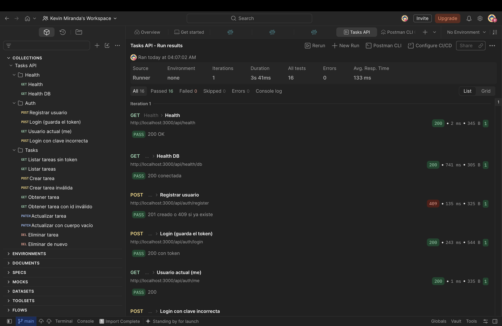
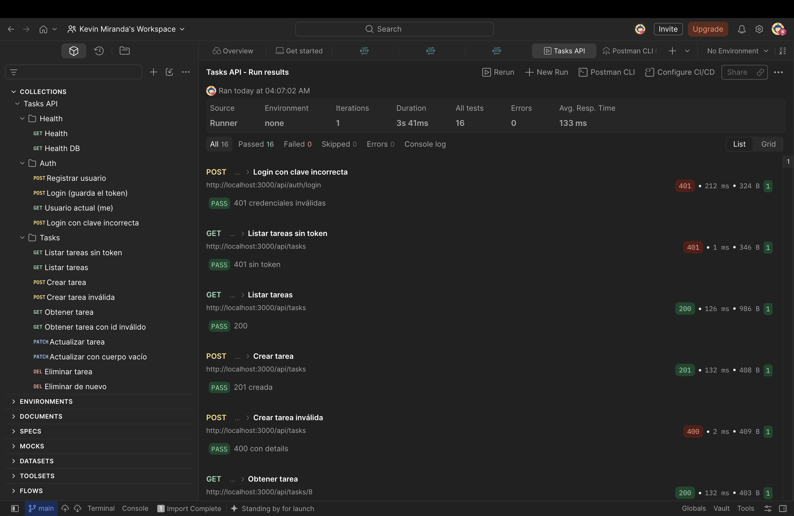
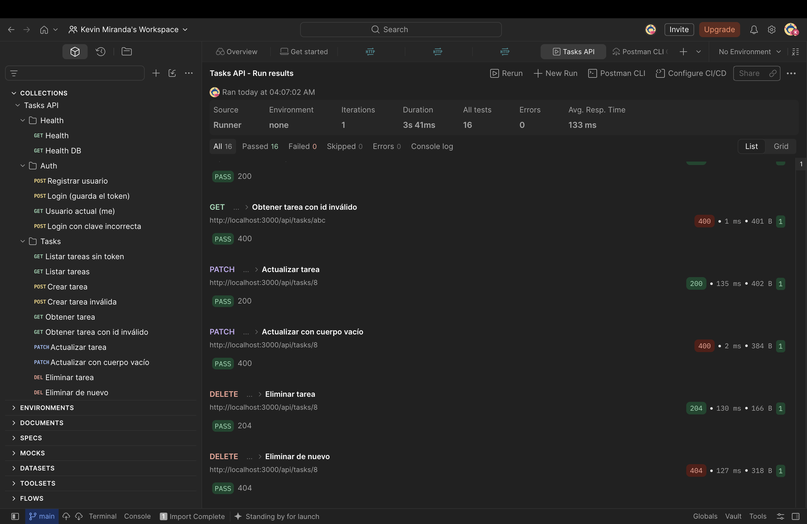

# Tarea: JWT + Usuarios

Se completan los **pasos 5, 6 y 7** del [TUTORIAL.md](./tasks-api/TUTORIAL.md): CRUD con validación, documentación con Swagger y autenticación con JWT. El proyecto está en [`tasks-api/`](./tasks-api).

| Paso | Qué se hizo | Dónde |
|------|-------------|-------|
| 5 | CRUD de tareas + validación con zod + errores 400/404 | `tasks-api/src/modules/tasks/` |
| 6 | Swagger (OpenAPI 3.1) en `/api/docs`, generado desde los schemas de zod | `tasks-api/src/docs/` y `*.docs.js` |
| 7 | Registro, login, `requireAuth` y botón Authorize en Swagger. Sin token → `401` | `tasks-api/src/modules/auth/`, `src/middlewares/auth.js`, `src/lib/jwt.js` |

Base de datos en Supabase: `tasks-api/supabase/01_tasks.sql` y `02_auth.sql`.

## Colección de peticiones en Postman

Archivo: [`tasks-api/postman/tasks-api.postman_collection.json`](./tasks-api/postman/tasks-api.postman_collection.json) (16 peticiones con pruebas).

Resultado del Runner: **16 pruebas pasadas, 0 fallidas**.





## Cómo correrlo

Instrucciones completas en [`tasks-api/README.md`](./tasks-api/README.md). Resumen:

```bash
cd tasks-api
cp .env.example .env   # completar SUPABASE_URL, SUPABASE_SECRET_KEY y JWT_SECRET
npm install
npm run dev            # http://localhost:3000/api/docs
```
